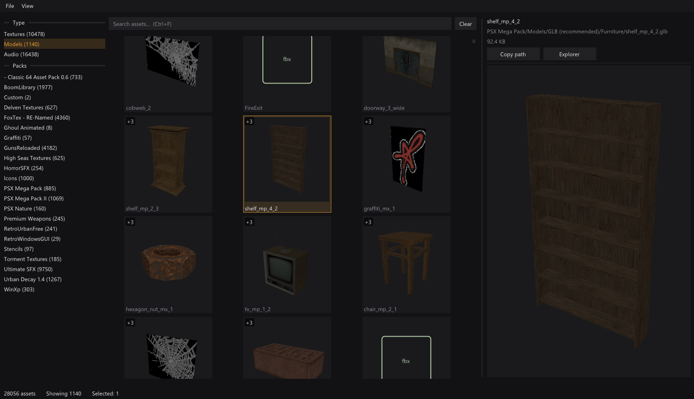
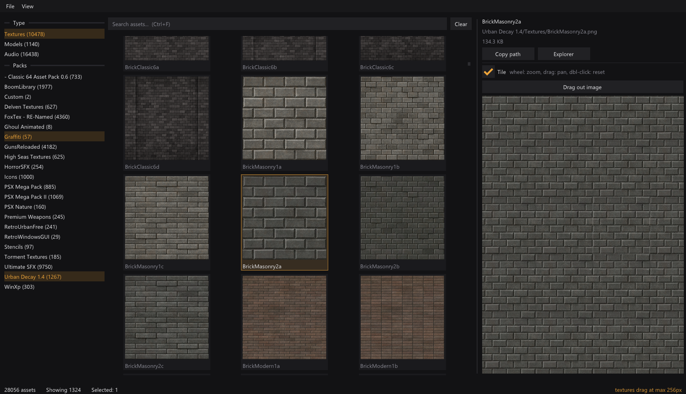
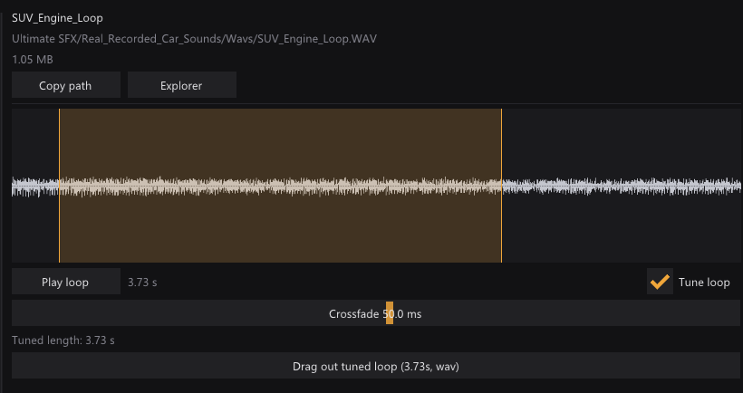

# Asset Browser

A fast native Windows browser for large game-asset libraries. Search, filter, preview,
and drag textures, models, and audio directly into tools such as Godot, Blender, and
Explorer.

<p align="center">
  
</p>

## What it does

- Fuzzy-searches filenames and paths, with filters for asset type and top-level pack.
- Previews textures, GLB models, and audio without opening another application.
- Drags original files or generated variants into any application that accepts files.
- Deduplicates equivalent model formats into one entry while preserving format choice.
- Exports resized textures, audio selections, and seamless audio loops on demand.
- Generates thumbnails in background workers and caches them for fast subsequent loads.
- Optional semantic search (bring your own OpenRouter key): rank textures, models and sounds
  by a text description, a pasted image or sound, or similarity to another asset.

<table>
  <tr>
    <td width="50%" valign="top">
      <br>
      <sub><b>Texture workflow</b> — browse, tile-preview, resize, and drag out.</sub>
    </td>
    <td width="50%" valign="top">
      <br>
      <sub><b>Audio workflow</b> — select, preview, crossfade, and export loops.</sub>
    </td>
  </tr>
</table>

Supported formats:

- Textures: PNG, JPG, BMP, TGA, GIF, PSD
- Models: GLB, glTF, FBX, OBJ, DAE
- Audio: WAV, OGG, MP3, FLAC

## Use

Launch the app, choose an asset folder, then search or filter the resulting grid. Click an
asset to preview it, double-click to reveal it in Explorer, or drag it into another app.
Right-click assets for alternate model formats and export options.

The selected folder is remembered and can be changed from **File → Change asset folder**.
Use `asset-browser.exe --root "D:\Assets"` for a one-off override.

Asset Browser scans recursively, ignores unrelated file types, and stores only settings,
thumbnail caches, and temporary exports under `%LOCALAPPDATA%\AssetBrowser`.

### Semantic search (textures, models and sounds)

Open **Semantic → Settings & indexing**, paste an [OpenRouter](https://openrouter.ai) API key
(or set `OPENROUTER_API_KEY`), and index your textures, models and/or sounds. Assets are
embedded with `google/gemini-embedding-2`: colour textures from their 256 px thumbnails
(about $0.12 per 1,000; normal/roughness and other auxiliary maps are skipped), models as a
six-view contact sheet rendered in-app (same price; GLB/glTF/FBX/OBJ), and sounds from their
first 12 seconds as 16 kHz mono audio (about $0.002 per clip). The window shows exact counts
and cost before anything is sent, and only new or changed files are sent on later runs.

Once indexed, tick **Semantic** next to the search box and press Enter to rank assets by
description; `type:`, `pack:`, `ext:` and the other filters still apply. Ctrl+V a
screenshot region, or paste/drop an image or sound file, to rank by example. Select an asset
and press **S** (or right-click → Find similar) to rank by similarity without any API call,
and in the audio preview select a range and click **Search similar** to search by that part
of a clip. The key is stored encrypted for the current Windows user; vectors live in
`%LOCALAPPDATA%\AssetBrowser\embeddings`.

## Build

Requires Windows 10+, CMake, and Visual Studio 2022. Dependencies are fetched by CMake.

```powershell
cmake -S . -B build -G "Visual Studio 17 2022" -A x64
cmake --build build --config Release
.\build\Release\asset-browser.exe
```

Built with C++20, Dear ImGui, Win32, and Direct3D 11.

## Release

Push a `vMAJOR.MINOR.PATCH` tag, or run the Release workflow manually. GitHub Actions
publishes a self-contained Windows x64 zip with a SHA-256 checksum.
