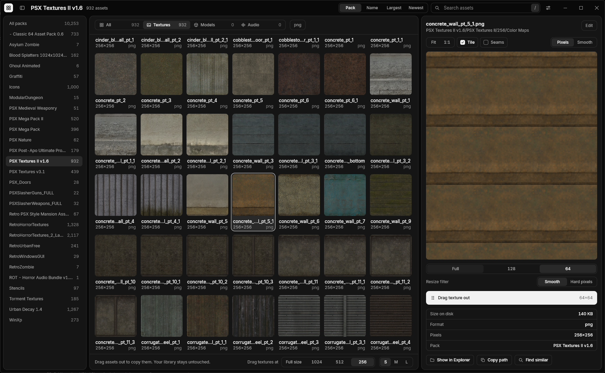
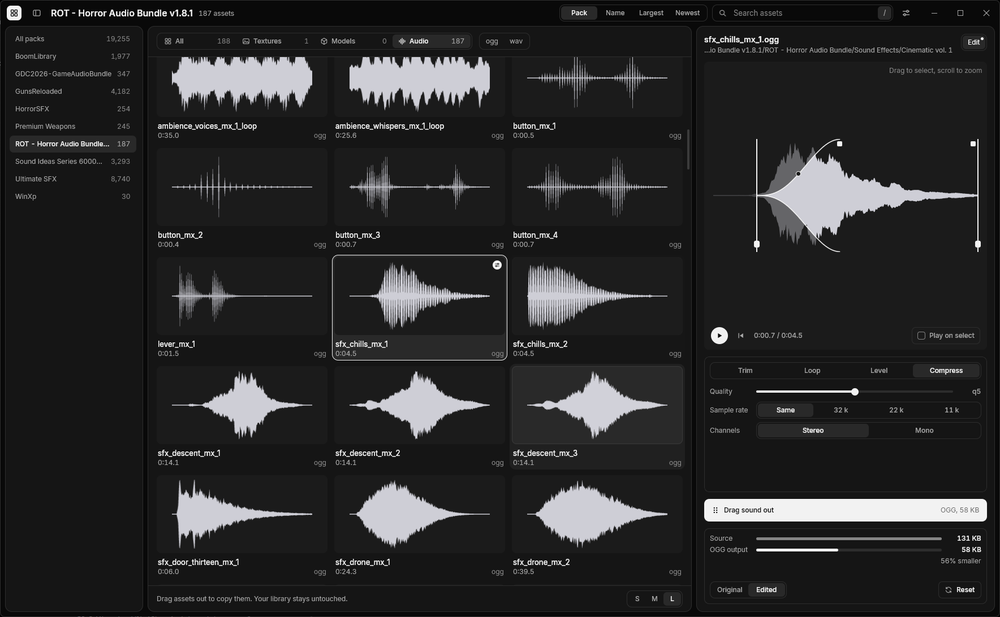
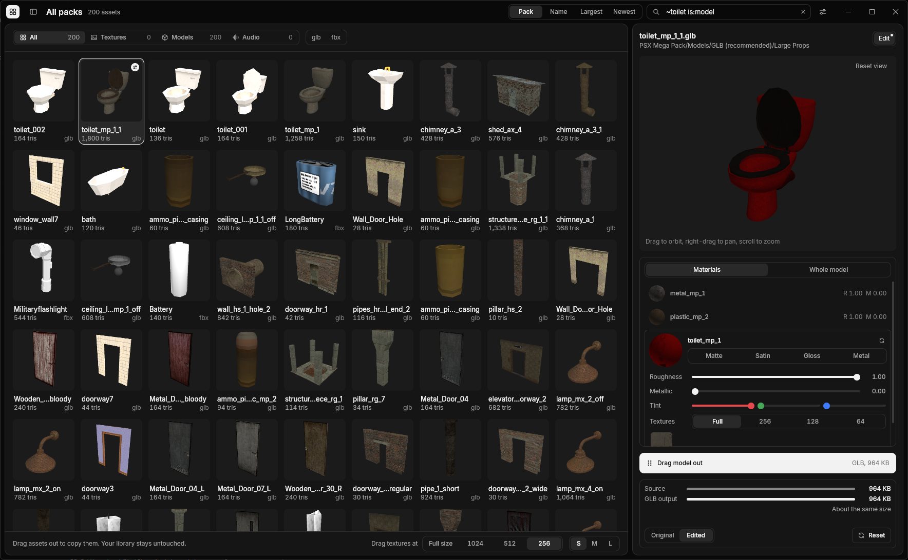
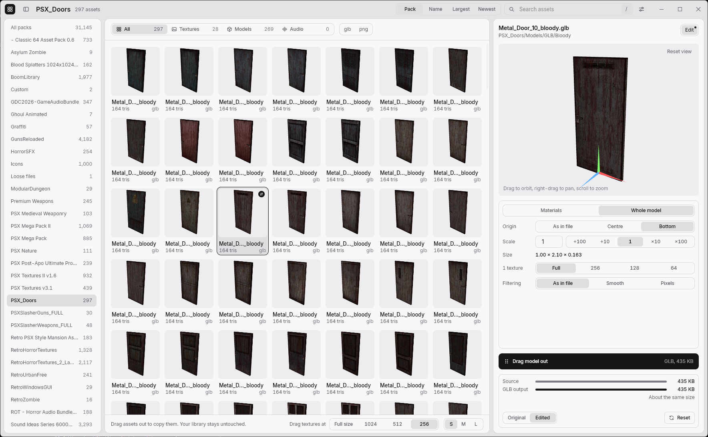

# Asset Browser

(Vibeslopped) Browse, preview, edit and drag out game assets on Windows. Library files are never changed. Built with [Rune](https://github.com/anomalyco/rune).

- Textures: png, jpg, bmp, tga, webp
- Models: glb, gltf, obj, dae, fbx
- Audio: wav, ogg, mp3, flac

Search by description is optional: a 625 MB download that runs locally.






## Install

Download the zip from [Releases](../../releases) and run `asset-browser.exe`. Set your asset folder in Settings.

## Build

```sh
cargo run --release
```

## License

MIT
